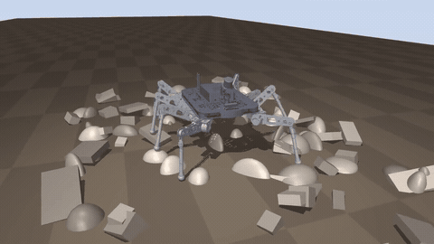
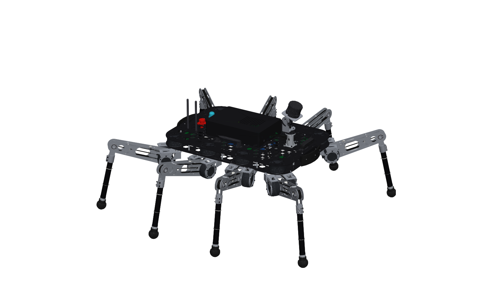
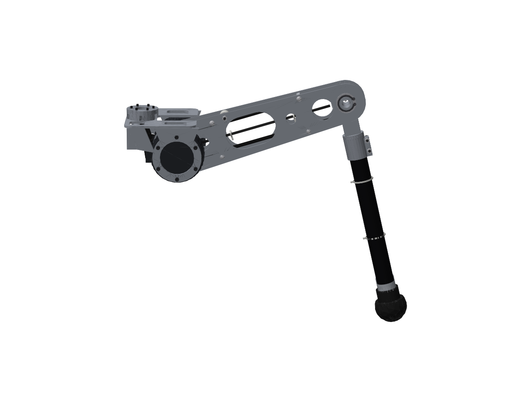

# Autonomous Spider

An eight-legged autonomous walking robot, designed as a full build rather than a render.
Every part is a Python program. The build exports a STEP assembly, a URDF and a MuJoCo
physics model. In simulation the robot then walks itself across fields of rocks using its
own LiDAR.



| | |
|---|---|
| **Parts** | **986**: 83 part numbers from 49 part programs |
| **Joints** | **30**: 24 leg revolutes (8 legs × 3), 2 sensor-head revolutes, 4 fixed sensor mounts |
| **Mass** | **55.0 kg** (54.999 kg, computed from the B-rep of every part) |
| **Motor drivers** | **26**: one FOC driver (48 V, 40 A, CAN-FD) per actuated joint |
| **Compute** | NVIDIA Jetson AGX Orin 64 GB |
| **Sensing** | 128-channel 360° 3D LiDAR on a pan/tilt head, stereo depth camera, tactical IMU, a load cell in every foot |
| **Actuators** | 24 × QDD-96 quasi-direct-drive (9:1, 110 N·m peak), 2 × GM-62 gimbal motors |
| **Power** | 48 V 13S4P 21700 Li-ion, 750 Wh |
| **Simulation** | **20 / 20 rock-field crossings, 0 falls**: 234 m over 10 m fields of rocks up to 16 cm, worst body tilt 2.4° |

All numbers in this README come from the build outputs (`build/summary.json`,
`build/sim/report*.json`). The test suite asserts them.

---

## Every part is a program

```
spider/parts/coxa_yoke.py        python -m spider.parts.coxa_yoke
spider/parts/shcs.py             python -m spider.parts.shcs d=4 L=12
...
```

Each module in [`spider/parts/`](spider/parts) is one runnable part program. It defines a
parametric `make(**params)` that returns CadQuery/OpenCascade geometry. A decorator attaches
the engineering data: part number, material (or datasheet mass for bought-in parts),
category and vendor. Run a module on its own and it writes that part's STEP and STL and
prints its mass properties:

```
$ python -m spider.parts.coxa_yoke
SP-2001  Coxa yoke, monolithic
  material   Al7075-T6  (machined, in-house)
  mass       490.6 g
  CoM (mm)   [...]
  wrote      build/parts/SP-2001.step / .stl
```

Standard hardware is parametric too. ISO 4762 / 7380 screws, DIN 985 nuts, 6805 bearings,
DIN 471 rings, dowels and standoffs each have one program that builds every size used.

[`spider/robot.py`](spider/robot.py) places every instance on its link and defines the
joints. It is the single description that all three exporters read, so the CAD, the
kinematics and the physics model cannot drift apart. Bolt patterns come from
[`spider/layout.py`](spider/layout.py), and the same lists cut the holes in the plates and
place the screws.

<p align="center"></p>

## The design

**One leg part number, eight times.** All eight legs are identical. Left and right are
rotations of each other, not mirror images.

<p align="center"></p>

* **Coxa (hip yaw):** a QDD-96 actuator is clamped between the chassis plates and drives
  a monolithic 5-axis 7075 **U-yoke**. The yoke has a hollow boss for the harness, two ring
  cheeks and a tubular tie bar, and is notched so the femur can pitch up 55° between its
  arms.
* **Femur (hip pitch):** the femur actuator hangs on the yoke's −y cheek. Its rotor bolts
  directly to a 320 mm box beam made from two 3 mm 7075 plates.
* **Knee (belt drive):** the knee actuator also sits at the hip, on the +y cheek. It drives
  the knee through a 1:1 HTD-5M belt inside the femur box, which has a tensioner idler.
  Keeping that mass at the hip makes the leg light at the end, and the motor angle equals
  the tibia's absolute pitch (femur + knee). The MJCF models this exactly as a fixed tendon.
* **Tibia:** a 32 mm roll-wrapped CFRP tube, clamped in a twin-cheek knuckle that hugs the
  knee pulley. The knee axle turns in two 6805 bearings in the femur plates.
* **Foot:** an aluminium core over a 500 N button load cell, inside a cast PU-85A boot.
  The load cell is the contact sensor the gait uses.

**Chassis:** two 2.5 mm hex-pocketed 6061 plates, 10 hex standoffs, and folded bulkheads
with PEM nuts form a torsion box 880 × 620 mm. The battery sits in the middle between the
plates. The 24 leg drivers sit in eight 3-slot PA12 card cages, one per leg, next to its hip.
The top deck carries the compute bay (Jetson, power distribution with e-stop contactor,
4-channel CAN-FD, GbE switch, DC-DCs, gimbal drivers), the sensor mast, carry handles,
e-stop, beacon and antennas.

**Mass budget (kg):**

| | kg | parts |
|---|---:|---:|
| Leg actuators (24 × QDD-96) | 23.04 | 24 |
| Leg structure + hardware | 14.26 | 688 |
| Chassis | 5.79 | 56 |
| Power (battery, clamps, bus) | 4.39 | 12 |
| Electronics (top deck) | 2.82 | 68 |
| Leg drivers + cages | 2.14 | 48 |
| Sensors (LiDAR, Jetson link, camera, IMU) | 0.98 | 10 |
| Sensor head (mast, gimbal) | 0.93 | 32 |
| Leg harness | 0.64 | 48 |
| **Total** | **55.00** | **986** |

The full BOM, with every part number, quantity, unit mass and the program that generates
it, is in [`build/bom.csv`](build/bom.csv).

## What the build exports

`python build.py` takes about 45 s:

| Output | |
|---|---|
| [`build/step/autonomous_spider.step`](build/step) | STEP AP214 assembly: all 986 parts named (`part-number:instance`), coloured and posed standing. Re-importing it gives back 986 leaf parts. |
| [`build/step/parts/*.step`](build/step/parts) | One STEP per part number (83) |
| [`build/model/spider.urdf`](build/model/spider.urdf) | URDF: 31 links, 30 joints, CAD inertials, per-link meshes, primitive collisions, transmissions |
| [`build/model/spider.xml`](build/model/spider.xml) | MJCF physics model: 26 torque motors with actuator limits, reflected rotor inertia, belt tendons, IMU, 8 foot touch sensors |
| [`build/bom.csv`](build/bom.csv), [`build/summary.json`](build/summary.json) | BOM, counts, link masses, export checks |

Link inertials come from the exact OpenCascade solid of every part. Each part's mass,
centre of mass and inertia tensor are rotated into the link frame and combined with the
parallel-axis theorem. `build.py` then loads **both** the MJCF and the URDF into MuJoCo and
asserts that their masses equal the CAD mass.

**Checks:**

* `tools/interference.py --sweep` intersects every pair of structural solids at the standing
  pose: **0 interferences**. It then sweeps the femur and knee through their full ranges and
  turns neighbouring legs 25° toward each other: all clear. Earlier passes of this check
  found real design errors: a yoke that hit the femur when it pitched up, a knuckle inside
  its tube, an e-stop too big for its cut-out, and corner hips that overhung the chassis.
  The geometry was fixed, and the femur limit set to −55° because the check shows −60°
  grazing the chassis.
* `pytest` (15 tests): part, joint and driver counts, mass, one driver per actuated joint,
  identical legs, IK/FK round-trip, analytic Jacobian, a standalone run of a part program,
  that the URDF and MJCF load, and closed-loop walking.

## Autonomy and the rock walk

```
LiDAR (mj_multiRay, 10 Hz, 5040 rays, 8 mm noise)   ──►  2.5-D elevation map (2 cm)
                                                           │
gait clock: 8-leg wave gait, duty 0.75 (6 feet down)  ──►  foothold choice: roughness under the
                                                           foot sphere + distance + confidence
desired body pose: level, fixed height over stance    ──►  swing: apex over the highest rock on
feet, heading held to the goal line                        the path, touchdown search, stumble reflex
                                                           │
world-fixed stance footholds → body frame → leg IK    ──►  joint PD + gravity feed-forward
                                                           → belt-coupled motor torques
                                                           → QDD-96 torque-speed limits (500 Hz)
```

[`sim/terrain.py`](sim/terrain.py) generates fields 10 m × 3.2 m of half-buried boulders,
tilted slabs and angular blocks, about 215–240 rocks per field.
[`sim/controller.py`](sim/controller.py) is the walking stack and
[`sim/perception.py`](sim/perception.py) is the LiDAR, mapping and foothold scoring.
[`sim/walk.py`](sim/walk.py) runs the trials. A trial counts as a **fall** if the body rolls
or pitches past 35°, or the chassis comes within 12 cm of the ground beneath it, at any
moment.

**Results** ([`build/sim/report.json`](build/sim/report.json)), 0.16 m/s commanded:

| field | rocks up to | trials | crossed 10 m | falls | worst body tilt | min chassis clearance | chassis–rock contacts | leg–leg contacts |
|---|---|---:|---:|---:|---:|---:|---:|---:|
| rocky | 12 cm | 10 | 10 | **0** | 2.4° | 0.25 m | 0 | 0 |
| boulders | 16 cm | 10 | 10 | **0** | 2.2° | 0.21 m | 0 | 0 |

That is 234 m walked and 7,762 footfalls, with no falls. Cost of transport is about 0.5
(positive mechanical work only).

**Perception ablation** ([`build/sim/report_blind.json`](build/sim/report_blind.json)):
the same 10 boulder fields, walked blind. Footholds stay at nominal, the swing apex is fixed,
and only touchdown search and the stumble reflex remain.

| boulders | crossed | falls | worst body tilt | stumble reflexes | min chassis clearance |
|---|---:|---:|---:|---:|---:|
| with LiDAR foothold planning | **10 / 10** | 0 | **2.2°** | **7** | 0.21 m |
| blind | 8 / 10 (2 stuck on rocks) | 0 | 20.9° | 483 | 0.19 m |

Blind, the robot still never fell: six feet are always down, so the gait is statically very
forgiving. But it hit rock faces 70× more often, tilted up to 21°, and got stuck twice.
The perception stack is what makes the walk clean.

## Limitations

* **State estimation is idealised.** The controller reads the body pose from the simulator,
  standing in for LiDAR-inertial odometry. Contact, terrain and joint state come from the
  robot's own simulated sensors.
* **The actuators are a specification, not a catalogue part.** QDD-96: 0.96 kg, 110 N·m
  peak, 14 rad/s. That is in the class of current quasi-direct-drive actuators (AK80-type),
  but it is not a specific product. The same goes for the driver board, LiDAR, camera, IMU
  and battery pack. Their envelopes and masses are datasheet-class and labelled `(spec)` in
  the BOM.
* **Some things are not modelled:** structural FEA, thread geometry, belt teeth (the belt
  is modelled at its tooth land) and harness routing. Harness runs are straight segments
  with the right length and mass, and are left out of the interference check.
* **Simulation is not the field.** The MuJoCo model has soft contacts, rigid links, ideal
  torque sources inside the torque–speed envelope, and no electrical model.

## Reproduce

```bash
pip install -r requirements.txt
python build.py                              # STEP + URDF + MJCF + BOM   (~45 s)
python tools/interference.py --sweep         # clearance checks            (~5 min)
python -m sim.walk --seeds 10                # 20 rock-field trials        (~6 min on 4 cores)
python -m sim.walk --seeds 1 --difficulty boulders --video build/sim/walk.mp4   # needs MUJOCO_GL=osmesa or egl
pytest
```

```
spider/
  config.py        every shared dimension and spec
  layout.py        positions + hole patterns used by both plates and screws
  parts/           49 part programs (one per part type)
  robot.py         986 instances, 31 links, 30 joints
  kinematics.py    leg FK / IK / Jacobian
  export/          STEP, URDF, MJCF, meshes, mass properties, BOM
sim/               terrain, perception, controller, trial runner
tools/             renderers, interference checker
tests/
build/             generated outputs (committed)
```
